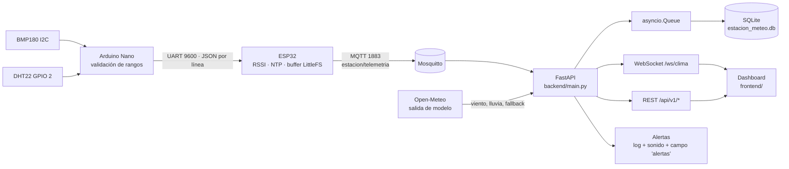

# Estación Meteorológica IoT

Backend FastAPI, dashboard en tiempo real, alertas y registro histórico de una
estación meteorológica de bajo costo. Los sensores envían telemetría por MQTT;
el backend la valida, la enriquece con el modelo de Open-Meteo, la persiste en
SQLite y la difunde a los navegadores por WebSocket.

## Estado actual del proyecto

- `origin/main` ya incluye todo el trabajo de `Pagina_Web` (PR #1, merge
  `a0c17ff`). Lo que se describe en este README es ese código unificado.
- `Pagina_Web` sigue siendo la rama de desarrollo y contiene los últimos
  cambios (al escribir esto, `4b00a20`: agregados diarios y corrección del
  WebSocket).
- La rama histórica V1.0 se renombró a `legacy/Estacion_Meteorologica_V1.0`
  en el remoto (`c72881b`).

## Repositorios relacionados

| Repositorio | Contenido |
|---|---|
| [`estacion_meteorologica`](https://github.com/EstebanBertoni/estacion_meteorologica) | Backend, dashboard, firmware e inventario (este repositorio). |
| [`estacion_meteorologica_datos`](https://github.com/EstebanBertoni/estacion_meteorologica_datos) | Dataset congelado `datos.csv` y su documentación de calidad. |

## Arquitectura general



La procedencia es explícita en todo el pipeline: la temperatura, humedad y
presión locales se marcan `fuente_sensores = "estacion"`; el viento y la lluvia
vienen del modelo y viajan con `fuente_viento` / `fuente_lluvia =
"open-meteo (modelo)"`. Ver [docs/ARQUITECTURA.md](docs/ARQUITECTURA.md).

## Requisitos

- Python 3.12 (probado en Windows).
- Broker Mosquitto con autenticación (`allow_anonymous false`).
- Dependencias Python: las de [`backend/requirements.txt`](backend/requirements.txt).
- Firmware: Arduino IDE con las librerías detalladas en
  [`firmware/README.md`](firmware/README.md).

## Instalación y ejecución

```powershell
git clone https://github.com/EstebanBertoni/estacion_meteorologica.git
cd estacion_meteorologica\backend
python -m venv .venv
.\.venv\Scripts\Activate.ps1
pip install -r requirements.txt
```

### Credenciales (no versionadas)

- Backend: crear `backend/credentials.py` con:

  ```python
  MQTT_USER = "usuario_mqtt"
  MQTT_PASS = "password_mqtt"
  ```

  Si el archivo no existe, el backend conecta sin credenciales y el broker lo
  rechaza; el log lo indica con `AUTENTICACIÓN RECHAZADA`.

- Firmware: copiar `firmware/credentials.h.example` a `credentials.h` y
  completar SSID/password Wi-Fi y la IP del broker.

Ambos archivos están en `.gitignore`.

### Levantar el backend

Ejecutar **desde `backend/`**, porque los archivos estáticos se montan como
`../frontend`:

```powershell
python -m uvicorn main:app --host 127.0.0.1 --port 8000
```

Abrir <http://127.0.0.1:8000>. El dashboard muestra `--` hasta que llega la
primera medición (el estado inicial es `None`, no `0`).

En Windows el servicio `EstacionBackend` (NSSM) corre en el puerto 8000; para
recargarlo hace falta un PowerShell como Administrador:

```powershell
Restart-Service EstacionBackend
```

### Probar sin hardware

```powershell
mosquitto_pub -h 127.0.0.1 -u USUARIO -P PASSWORD `
  -t "estacion/telemetria" `
  -m '{"t_dht":25.5,"humedad":60,"t_bmp":25.0,"presion":1010,"rssi":-55,"ts_epoch":1795836790}'
```

## Configuración

Las constantes están al inicio de `backend/main.py`:

| Constante | Valor | Uso |
|---|---|---|
| `BROKER_IP` | `127.0.0.1` | Host del broker MQTT. |
| `MQTT_PORT` | `1883` | Puerto MQTT. |
| `MQTT_TOPIC` | `estacion/telemetria` | Tópico suscripto. |
| `ALTURA_M` | `90.0` | Altura de referencia para derivadas. |
| `LATITUD_ESTACION` / `LONGITUD_ESTACION` | `-31.2262` / `-61.4903` | Punto de interpolación de Open-Meteo (Rafaela, Santa Fe). |
| `INTERVALO_REFERENCIA_S` | `900` | Consulta al modelo. |
| `INTERVALO_AGREGADOS_S` | `60` | Recálculo de agregados diarios. |
| `FALLBACK_SENSOR_S` | `60.0` | Tiempo sin telemetría válida antes de usar el modelo. |
| `FALLBACK_INTERVALO_S` | `60.0` | Cadencia de publicación del fallback. |
| `INTERVALO_RECONEXION_MQTT` | `5` | Reintento de conexión al broker. |

## Contrato MQTT

| Campo | Alias aceptado | Rango válido | Unidad |
|---|---|---|---|
| `t_dht` | `temp_dht` | −50 … 60 | °C |
| `humedad` | `hum` | 0 … 100 | % HR |
| `t_bmp` | `temp_bmp` | −50 … 60 | °C |
| `presion` | `press` | 300 … 1100 | hPa |
| `rssi` | — | entero | dBm |
| `ts_epoch` | — | ≥ 1.700.000.000 | s UTC |

El firmware además publica `ip_esp32`, `red_ssid`, `bmp_ok` y `dht_ok`;
esos metadatos no se persisten. `ts_epoch` se convierte a `ts_adquisicion`
solo si es razonablemente reciente; si no, se guarda `NULL`, nunca una hora
falsa.

## Procedencia, modelo y fallback

- **Open-Meteo es modelo, no medición instrumental.** Aporta viento
  (`vel_viento`, `raf_viento`, `viento_direccion`), lluvia (`lluvia_mm_h`),
  probabilidad horaria (`prob_lluvia`) y los valores de fallback.
- Cada valor viaja con `fuente_viento` / `fuente_lluvia =
  "open-meteo (modelo)"`, y se guarda en `referencia_openmeteo`, tabla
  separada de `mediciones`.
- Si no llega telemetría válida durante 60 s, `tarea_fallback_sensores`
  reemplaza temperatura, humedad y presión por valores del modelo y marca
  `fuente_sensores = "open-meteo (fallback)"`. Al volver la estación,
  `on_message` restaura `"estacion"` automáticamente.
- Los registros de fallback entran al mismo pipeline y se persisten en
  `mediciones`, pero son identificables por su procedencia.

## Alertas

Umbrales definidos en `backend/funciones/alerta.py`:

| Magnitud | Umbral |
|---|---|
| Temperatura DHT22 | 38 °C |
| Viento (modelo) | 60 km/h |
| Lluvia (modelo) | 50 mm |

`evaluar_alertas()` es pura y devuelve mensajes; `activar_sonido()` reproduce
la alarma en un hilo aparte con **cooldown de 60 s** (archivo MP3 incluido, con
beep del sistema como respaldo). Los mensajes activos se exponen en el campo
`alertas` del WebSocket y se registran en el log.

## Agregados diarios

`tarea_agregados()` recalcula cada 60 s, sobre el día local (UTC-3):

| Campo | Origen |
|---|---|
| `temp_min`, `temp_max`, `hum_min`, `hum_max`, `Max_viento` | `mediciones` del día. |
| `prom_temp`, `prom_hum` | Media móvil de la última hora. |
| `acum_lluvia` (alias `acum_viento`) | Suma horaria del modelo en `referencia_openmeteo`. |
| `prob_lluvia` | Máxima probabilidad horaria del modelo para hoy. |

Se reinyectan en `latest_data` cada vez que llega MQTT o una referencia nueva,
para que no desaparezcan del dashboard.

## Estado en memoria y magnitudes derivadas

`latest_data` contiene telemetría, derivadas (`altitud`, `punto_rocio`,
`sensacion_termica`, `humedad_absoluta`, `vpd`, `bulbo_humedo`, `base_nubes`,
`presion_mar`, `densidad_aire`), viento/lluvia del modelo, agregados,
`alertas` y los campos de procedencia.

La altura barométrica es una **estimación** con presión de referencia fija,
no una medición: no debe interpretarse como altura real.

## API HTTP y WebSocket

| Endpoint | Descripción |
|---|---|
| `GET /` | Dashboard (`frontend/index.html`). |
| `GET /health` | Estado para el monitor del servicio: MQTT, última medición, alertas, fallback. |
| `GET /api/v1/actual` | Estado completo `latest_data`. |
| `GET /api/v1/historial?limite=100` | Últimas N mediciones (1 … 1000), más recientes primero. |
| `GET /api/v1/referencia` | Última observación de Open-Meteo o `{"estado":"SIN_DATOS"}`. |
| `WS /ws/clima` | Envía el estado al conectarse y una copia actualizada en cada cambio. |

Ejemplo de `/health`:

```json
{
  "estado": "ok",
  "mqtt": "conectado",
  "ultima_medicion": "2026-11-28T04:19:06+00:00",
  "alertas_activas": 0,
  "fuente_sensores": "estacion",
  "usando_fallback": false
}
```

## Persistencia

`init_db()` crea/migra dos tablas:

- **`mediciones`**: una fila por mensaje MQTT válido (≈1 cada 3 s). Guarda
  `ts_adquisicion`, `fecha_hora` (recepción en el servidor), sensores, RSSI,
  derivadas, viento/lluvia del modelo y `fuente_sensores`. Los valores
  ausentes se guardan como `NULL`. Tiene índice por `fecha_hora`.
- **`referencia_openmeteo`**: histórico canónico del modelo, con índice
  único por `fecha_observacion` (reconsultar no duplica filas). Incluye
  `lluvia_mm_h` y `prob_lluvia`.

Las migraciones `ALTER TABLE` son automáticas para bases preexistentes.

## Firmware

Los sketches del Nano y el ESP32, el protocolo serial, el cableado y el
buffer LittleFS están documentados en [`firmware/README.md`](firmware/README.md).

## Estructura

```text
estacion_meteorologica/
├── backend/
│   ├── main.py                 # FastAPI: MQTT, WS, REST y tareas
│   ├── requirements.txt
│   ├── credentials.py          # gitignoreado
│   └── funciones/
│       ├── database.py         # Esquema, inserción y consultas
│       ├── openmeteo.py        # Cliente del modelo + prob_lluvia
│       ├── consultar_datos.py  # Agregados diarios
│       ├── alerta.py           # Umbrales, cooldown y sonido
│       └── sucriber.py         # Suscriptor de depuración
├── docs/
│   └── ARQUITECTURA.md
├── firmware/
│   ├── Test_Nano_sensores.ino
│   ├── Test_MQTT_buffer.ino
│   ├── credentials.h.example
│   └── README.md
├── frontend/
│   ├── index.html
│   ├── app.js
│   └── style.css
└── INVENTARIO.md               # Inventario de archivos del proyecto
```

## Historial de ramas

| Rama | Contenido |
|---|---|
| `main` (`origin/main`) | Código unificado tras el merge de `Pagina_Web` (`a0c17ff`). |
| `Pagina_Web` | Rama de desarrollo; incluye agregados diarios y el fix del WebSocket (`4b00a20`). |
| `legacy/Estacion_Meteorologica_V1.0` | Rama histórica renombrada en el remoto (`c72881b`). |
| `Estacion_Meteorologica_V1.0` | Versión inicial V1.0 (rama local histórica). |

## Datos históricos

El dataset `datos.csv` vive en el
[repo de datos](https://github.com/EstebanBertoni/estacion_meteorologica_datos),
no en este. Proviene del buffer local del ESP32 anterior a MQTT: tiene
timestamps inválidos, tramos congelados y una fila truncada. Antes de usarlo,
leer la [guía de validación](https://github.com/EstebanBertoni/estacion_meteorologica_datos/blob/main/docs/VALIDACION.md).

## Limitaciones

- CORS abierto (`*`) y sin autenticación en HTTP ni WebSocket: apto para red
  local, no para exposición pública. MQTT sí requiere credenciales.
- Las llamadas a SQLite son síncronas dentro del loop de asyncio.
- El dashboard depende de que el backend se ejecute desde `backend/` por las
  rutas `../frontend`.
- La procedencia del viento y la lluvia es modelo; nunca debe presentarse como
  medición instrumental de la estación.
