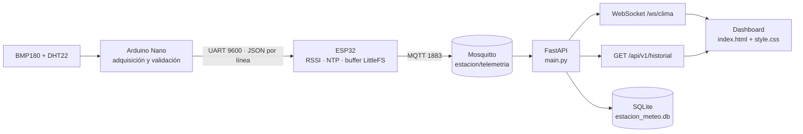

# Estación Meteorológica IoT

Backend, dashboard en tiempo real y registro histórico de una estación
meteorológica de bajo costo. Los sensores envían telemetría por MQTT a un
servicio FastAPI, que la difunde a los navegadores por WebSocket y la
persiste en SQLite.

## Repositorios relacionados

| Repositorio | Contenido |
|---|---|
| [`estacion_meteorologica`](https://github.com/EstebanBertoni/estacion_meteorologica) | Código del backend, dashboard y firmware histórico (este repositorio). |
| [`estacion_meteorologica_datos`](https://github.com/EstebanBertoni/estacion_meteorologica_datos) | Dataset congelado `datos.csv` y su documentación de calidad. |

## Arquitectura general



El hardware (Nano + ESP32) y el pipeline completo están en la rama
`Pagina_Web`. La rama `main`, documentada aquí, contiene el backend y el
dashboard. Consultá [docs/ARQUITECTURA.md](docs/ARQUITECTURA.md) para el
detalle de componentes, contratos y flujos.

## Requisitos

- Python 3.12 (probado en Windows).
- Broker MQTT Mosquitto accesible en `127.0.0.1:1883`.
- Dependencias Python: `fastapi`, `uvicorn`, `paho-mqtt`.

> La rama `Pagina_Web` incluye `backend/requirements.txt` con versiones
> fijadas. En `main` no hay archivo de requisitos, así que se instalan
> directamente.

## Instalación y ejecución

```powershell
git clone https://github.com/EstebanBertoni/estacion_meteorologica.git
cd estacion_meteorologica
python -m venv .venv
.\.venv\Scripts\Activate.ps1
pip install fastapi uvicorn paho-mqtt
```

Iniciar Mosquitto (en Windows, por ejemplo, `net start mosquitto`) y luego
levantar la aplicación **desde la raíz del repositorio**:

```powershell
uvicorn main:app --reload
```

Abrir <http://127.0.0.1:8000>. El dashboard queda en estado
`Conectando...`/`Reconectando...` hasta que llegue el primer mensaje MQTT.

Para probar sin hardware:

```powershell
mosquitto_pub -h 127.0.0.1 -t "estacion/telemetria" `
  -m '{"t_dht":21.5,"humedad":55.2,"t_bmp":19.8,"presion":1013.2,"rssi":-45}'
```

### Configuración

Las constantes están al inicio de `main.py`:

| Constante | Valor | Uso |
|---|---|---|
| `BROKER_IP` | `127.0.0.1` | Host del broker MQTT. |
| `PORT` | `1883` | Puerto MQTT. |
| `TOPIC` | `estacion/telemetria` | Tópico suscripto. |

El guardado en SQLite ocurre cada **300 s** (la primera escritura a los
10 s de iniciar el servicio). `index.html` y `estacion_meteo.db` se
resuelven con rutas relativas al directorio de trabajo, por eso es
importante ejecutar `uvicorn` desde la raíz.

## Contrato de datos

### Mensaje MQTT publicado por la pasarela

```json
{
  "t_dht": 21.5,
  "humedad": 55.2,
  "t_bmp": 19.8,
  "presion": 1013.2,
  "rssi": -45
}
```

`main.py` acepta aliases para tolerar versiones distintas del firmware:
`temp_dht` → `t_dht`, `hum` → `humedad`, `temp_bmp` → `t_bmp`,
`press` → `presion`. `rssi` no tiene alias. Los valores no numéricos se
descartan con un mensaje de error en el log.

### Estado en memoria

Cada mensaje actualiza `latest_data` y calcula tres magnitudes derivadas:

| Campo | Origen / fórmula |
|---|---|
| `altitud` | `44330 * (1 - (presion / 1032) ** 0.1903)` |
| `punto_rocio` | Aproximación de Magnus con `a=17.27`, `b=237.7` |
| `sensacion_termica` | Heurística con humedad para `t_dht >= 20 °C`; si no, `t_dht` |

La altitud es una **estimación barométrica** con presión de referencia
fija (1032 hPa), no una medición: refleja ruido de presión y no debe
interpretarse como altura real. El dataset histórico muestra oscilaciones
de 32–44 m en el mismo lugar.

## API HTTP y WebSocket

| Endpoint | Descripción |
|---|---|
| `GET /` | Devuelve `index.html`. |
| `GET /api/v1/historial?limite=100` | Últimas N mediciones de SQLite, en orden descendente por `id`. |
| `WS /ws/clima` | Envía el estado actual al conectarse y luego cada mensaje MQTT. |

Ejemplo de respuesta del histórico:

```json
[
  {
    "id": 7,
    "fecha_hora": "2026-09-13 15:26:32",
    "temp_dht": 20.8,
    "humedad": 54.8,
    "temp_bmp": 18.6,
    "presion": 1020.64,
    "altitud": 93.3,
    "punto_rocio": 11.4,
    "sensacion_termica": 15.2,
    "rssi": -33
  }
]
```

El frontend elige `ws://` o `wss://` según el protocolo de la página,
reenvía el estado a ocho tarjetas y reconecta automáticamente cada 3 s si
se cierra la conexión.

## Persistencia

`database.py` crea la tabla `mediciones` en `estacion_meteo.db`:

| Columna | Tipo | Descripción |
|---|---|---|
| `id` | INTEGER PK | Autoincremental. |
| `fecha_hora` | TEXT | `datetime.now()` del servidor, formato `YYYY-MM-DD HH:MM:SS`. |
| `temp_dht` | REAL | Temperatura DHT22. |
| `humedad` | REAL | Humedad relativa. |
| `temp_bmp` | REAL | Temperatura del sensor barométrico. |
| `presion` | REAL | Presión en hPa. |
| `altitud` | REAL | Estimación derivada. |
| `punto_rocio` | REAL | Magnitud derivada. |
| `sensacion_termica` | REAL | Magnitud derivada. |
| `rssi` | INTEGER | Intensidad de señal Wi-Fi. |

No se insertan registros cuando `t_dht` es `0` (valor centinela del estado
inicial). El timestamp es del servidor, no del dispositivo: esta rama no
guarda `ts_adquisicion`.

## Estructura

```text
estacion_meteorologica/
├── main.py              # FastAPI: MQTT, WebSocket, REST, tareas periódicas
├── database.py          # Esquema SQLite e inserción/consulta
├── index.html           # Dashboard en tiempo real
├── style.css            # Estilos del dashboard
├── sucriber.py          # Suscriptor MQTT de prueba (ver observaciones)
├── datos.csv            # Copia del dataset histórico
├── estacion_meteo.db    # Base SQLite local
└── docs/
    └── ARQUITECTURA.md  # Detalle de flujos y decisiones de diseño
```

## Observaciones y limitaciones

- `latest_data` se inicializa en `0.0`; antes del primer mensaje, un cliente
  WebSocket ve ceros en lugar de "sin dato".
- `sucriber.py` es una herramienta de depuración independiente, **no la usa
  el backend**, y su tópico (`estacion/telemtria`) tiene un typo respecto de
  `estacion/telemetria`.
- El dashboard rotula la tarjeta como `Temp. BMP280`, pero el firmware de la
  rama `Pagina_Web` usa un **BMP180** (confirmado en el driver y en el README
  de firmware).
- CORS permite todos los orígenes y no hay autenticación en MQTT, HTTP ni
  WebSocket: apto para entorno local, no para exposición pública.
- Las llamadas a SQLite son síncronas dentro del loop de asyncio.
- La rama `Pagina_Web` agrega credenciales MQTT, timestamp de adquisición,
  datos de viento, referencia de Open-Meteo, más métricas derivadas y
  firmware de ambos nodos. Es código de la misma línea de desarrollo, pero
  no está fusionado en `main`.

## Historial de ramas

| Rama | Contenido |
|---|---|
| `main` | Estado actual: backend FastAPI + dashboard (commit `Estacion Meteorologica V1.1`). |
| `Estacion_Meteorologica_V1.0` | Versión inicial V1.0. |
| `Pagina_Web` | Firmware Nano/ESP32, backend modular, dashboard extendido y pruebas. |

## Datos históricos

La copia `datos.csv` proviene del buffer local del ESP32 anterior a la
arquitectura MQTT: 4643 muestras de ~88 min con timestamps inválidos,
tramos congelados y la última fila truncada. Antes de usarla, leer el
[README del repo de datos](https://github.com/EstebanBertoni/estacion_meteorologica_datos)
y [su guía de validación](https://github.com/EstebanBertoni/estacion_meteorologica_datos/blob/main/docs/VALIDACION.md).
