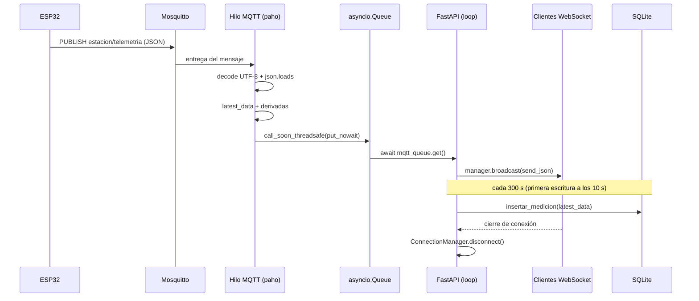
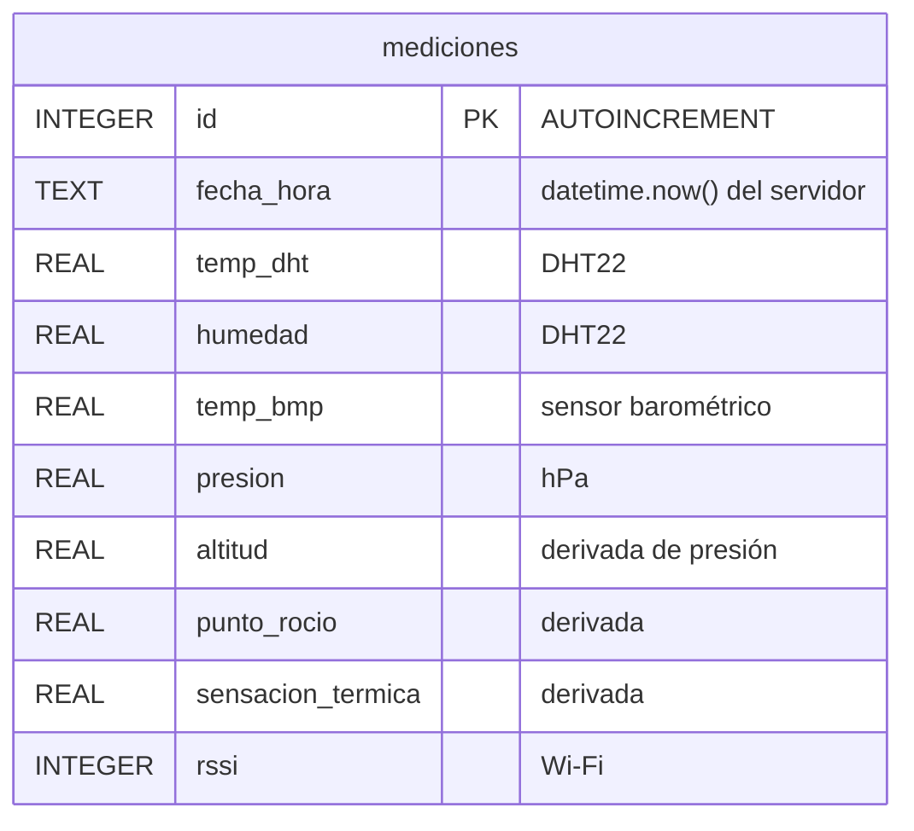

# Arquitectura de la estación meteorológica

Documentación técnica del sistema completo (hardware, transporte, backend y
presentación). El código ejecutable en la rama `main` es el backend simple;
el firmware y el backend modular viven en la rama `Pagina_Web`.

## 1. Contexto y componentes

```mermaid
flowchart TB
    subgraph Campo["Campo (rama Pagina_Web)"]
        BMP["BMP180 I2C"]
        DHT["DHT22 GPIO 2"]
        NANO["Arduino Nano<br/>lee y valida rangos físicos"]
        ESP["ESP32<br/>puente serial→MQTT,<br/>RSSI, NTP, buffer LittleFS"]
        BMP --> NANO
        DHT --> NANO
        NANO -->|"UART 9600 · JSON<br/>por línea"| ESP
    end

    subgraph Servidor["Servidor local (rama main)"]
        BROKER[("Mosquitto<br/>puerto 1883")]
        BACKEND["FastAPI · main.py"]
        QUEUE["asyncio.Queue"]
        DB[("SQLite<br/>estacion_meteo.db")]
        BROKER --> BACKEND
        BACKEND --> QUEUE
        BACKEND --> DB
    end

    subgraph Cliente["Navegador"]
        DASH["index.html + style.css<br/>8 tarjetas + WebSocket"]
    end

    ESP -->|PUBLISH<br/>estacion/telemetria| BROKER
    BACKEND -->|WebSocket /ws/clima| DASH
    BACKEND -->|REST /api/v1/historial| DASH
```

### Responsabilidades por archivo

| Archivo | Responsabilidad | Contexto de ejecución |
|---|---|---|
| `main.py` | Configuración, callbacks MQTT, cola asyncio, endpoints, tareas periódicas y cálculos derivados. | Loop principal de asyncio + un hilo daemon para paho-mqtt. |
| `database.py` | DDL de `mediciones`, inserción y consulta. | Llamado desde el loop de asyncio (bloqueante). |
| `index.html` | Conexión WebSocket, reconexión y actualización del DOM. | Navegador. |
| `style.css` | Tema oscuro, grilla de tarjetas e indicador de estado. | Navegador. |
| `sucriber.py` | Suscriptor MQTT de depuración; imprime el payload recibido. | Proceso independiente, no usado por `main.py`. |

## 2. Secuencia de una medición

Puntos clave:

1. El callback de paho corre en un hilo distinto al loop de asyncio; por
   eso usa `call_soon_threadsafe` para publicar en la cola.
2. `ConnectionManager` mantiene la lista de WebSockets activos; al enviar,
   itera sobre una copia y descarta los clientes que fallan.
3. Al conectarse, cada WebSocket recibe inmediatamente `latest_data`;
   después recibe un JSON por cada mensaje MQTT.
4. La persistencia es independiente de la recepción: se escribe el último
   estado conocido, no cada medición recibida.

## 3. Contrato MQTT

- Broker: `127.0.0.1:1883` (configurable en `main.py`).
- Tópico: `estacion/telemetria`.
- QoS: 0 (default de paho). Sin retención ni autenticación en `main`.
- Formato: un objeto JSON por mensaje.

| Campo esperado | Alias aceptado | Tipo | Unidad |
|---|---|---|---|
| `t_dht` | `temp_dht` | float | °C |
| `humedad` | `hum` | float | % HR |
| `t_bmp` | `temp_bmp` | float | °C |
| `presion` | `press` | float | hPa |
| `rssi` | — | int | dBm |

El firmware de la rama `Pagina_Web` publica además `ip_esp32`, `red_ssid`,
`ts_epoch` (o `null` si NTP no sincronizó), `bmp_ok` y `dht_ok`; el backend
de `main` ignora esas claves.

El backend de `Pagina_Web` completa el estado con **viento y lluvia de
Open-Meteo** (`vel_viento`, `raf_viento`, `lluvia_mm_h`). Son salida de
modelo, no medición instrumental: viajan con `fuente_viento` /
`fuente_lluvia = "open-meteo (modelo)"` y se persisten en `mediciones` con
esa procedencia. La tabla `referencia_openmeteo` sigue siendo el histórico
canónico del modelo.

Si no llega ninguna medición válida durante **60 s**, `tarea_fallback_sensores`
reemplaza temperatura, humedad y presión por valores del modelo y lo marca
con `fuente_sensores = "open-meteo (fallback)"`. Esos registros entran al
mismo pipeline MQTT→SQLite→WebSocket, pero se distinguen del dato
instrumental. Al volver la estación, `on_message` restaura
`fuente_sensores = "estacion"` automáticamente.

### Enriquecimiento en el backend

| Magnitud | Implementación | Observación |
|---|---|---|
| `altitud` | `44330 * (1 - (p / 1032) ** 0.1903)`, redondeado a 1 decimal. | Presión de referencia fija; es ruido barométrico, no altura real. |
| `punto_rocio` | Magnus: `alpha = 17.27*T/(237.7+T) + ln(HR/100)`; `Tr = 237.7*alpha/(17.27-alpha)`. | Devuelve `0.0` si temperatura o humedad son exactamente `0`. |
| `sensacion_termica` | Para `T >= 20 °C`: `0.5*(T + 61 + (T-68)*1.2 + HR*0.094)`. | Mezcla constantes en °F con entradas en °C; es una heurística, no un índice normalizado. |

## 4. Modelo de datos persistido

- `init_db()` usa `CREATE TABLE IF NOT EXISTS`: no hay migraciones.
- `insertar_medicion()` descarta el estado inicial (`t_dht == 0`).
- `obtener_historial(limite)` ordena por `id DESC` y limita el resultado.
- No hay índice explícito más allá de la clave primaria; el volumen esperado
  es bajo (una fila cada 5 min).

## 5. Tareas y concurrencia

| Tarea | Tipo | Ciclo | Fallo / recuperación |
|---|---|---|---|
| `start_mqtt_loop()` | Hilo daemon | `connect` + `subscribe` + `loop_forever()` | Reintenta cada 5 s ante excepción. No hay `on_connect` para resuscribir en reconexiones internas de paho. |
| `process_mqtt_queue()` | asyncio task | `await queue.get()` infinito | Sin tiempo de espera; solo termina al cerrar el proceso. |
| `guardar_datos_periodicamente()` | asyncio task | Espera 10 s, luego cada 300 s | Escritura SQLite bloqueante; excepciones no capturadas. |
| WebSocket del navegador | JS en el cliente | `connect()` + reconexión con `setTimeout` de 3 s | Indicador "Desconectado / Conectando / En vivo / Reconectando". |

## 6. Datos históricos vs. telemetría actual

| Aspecto | `datos.csv` (repo de datos) | `estacion_meteo.db` (rama `main`) |
|---|---|---|
| Origen | Buffer local del ESP32 (firmware anterior). | Mensajes MQTT + reloj del servidor. |
| Frecuencia | ~1 Hz, 4643 filas, ~88 min. | 1 fila cada 300 s. |
| Timestamp | Contador sin sincronizar (epoch inválido de ~1996). | `datetime.now()` local. |
| Columnas | `timestamp, t_bmp, presion_hpa, altitud, t_dht, humedad`. | 10 columnas con derivadas y RSSI. |
| Uso | Desarrollo y pruebas de calidad de datos. | Histórico operativo del dashboard. |

No se mezclan en consultas: cada fuente tiene su propio esquema y su
propio repositorio. Ver la [guía de validación](https://github.com/EstebanBertoni/estacion_meteorologica_datos/blob/main/docs/VALIDACION.md).

## 7. Modos de falla y decisiones pendientes

| Riesgo | Situación actual | Mejora sugerida |
|---|---|---|
| Rutas relativas | `index.html` y la BD dependen del directorio de trabajo. | Resolver rutas con `Path(__file__).parent`. |
| Estado inicial | Ceros que parecen mediciones reales. | Inicializar en `None` (ya lo hace la rama `Pagina_Web`). |
| Suscripción MQTT | Se llama una vez tras `connect()`; no hay callback `on_connect`. | Suscribirse en `on_connect`. |
| Persistencia | Se pierden muestras entre escrituras; no hay `ts_adquisicion`. | Guardar cada mensaje o usar el timestamp del dispositivo. |
| SQLite en asyncio | Llamadas bloqueantes. | `run_in_executor` o cliente asíncrono. |
| Seguridad | CORS `*`, sin autenticación. | Credenciales MQTT y restricción de orígenes. |
| Dependencias | Sin `requirements.txt` en `main`. | Incorporar el de `backend/requirements.txt` de `Pagina_Web`. |

## 8. Evolución por ramas

| Rama | Incorpora |
|---|---|
| `Estacion_Meteorologica_V1.0` | Primera versión del backend y dashboard. |
| `Pagina_Web` | Firmware Nano (BMP180 + DHT22, validación de rangos) y ESP32 (LittleFS, NTP, RSSI); backend modular con `credentials.py` gitignoreado, `ts_adquisicion`, viento y lluvia del modelo inyectados en el WebSocket/DB con procedencia explícita, referencia Open-Meteo separada, índice por fecha, alertas con umbrales y más variables derivadas. |
| `main` | Versión simplificada V1.1 usada como entrada al proyecto. |
