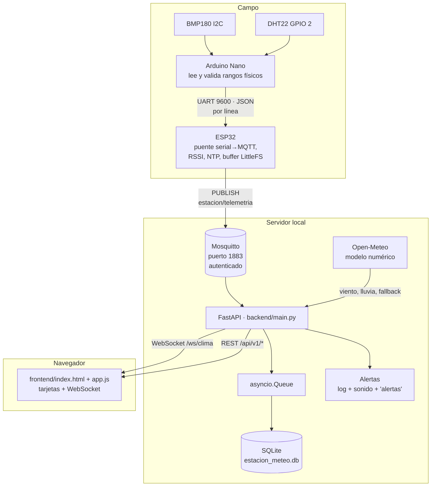
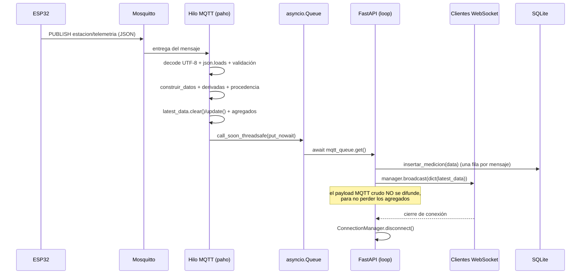
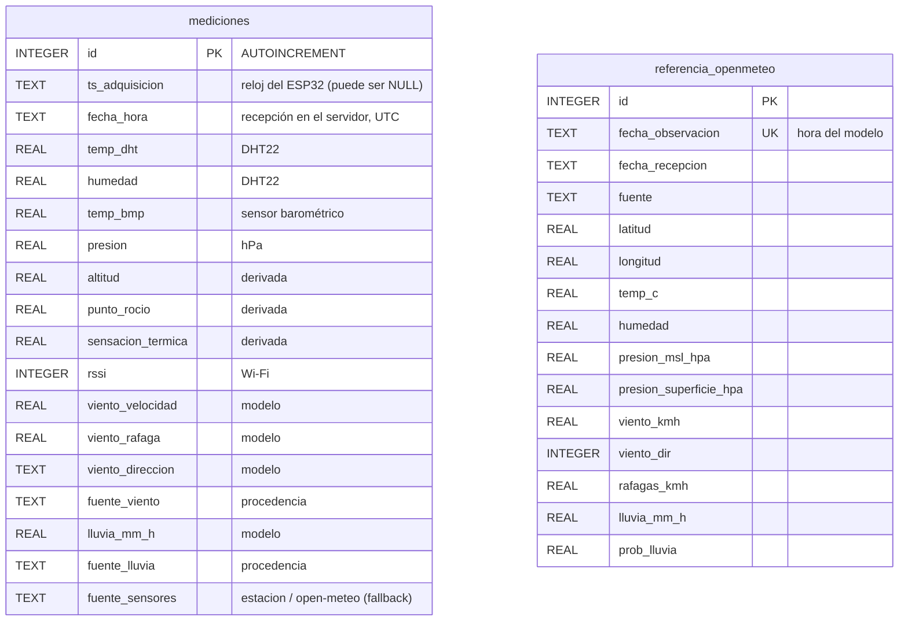

# Arquitectura de la estación meteorológica

Documentación técnica del sistema completo: hardware, transporte, backend,
procedencia de los datos y presentación. El código ejecutable de `main` es el
resultado de fusionar `Pagina_Web` (PR #1, merge `a0c17ff`); `Pagina_Web`
sigue como rama de desarrollo con los últimos cambios.

## 1. Contexto y componentes

### Responsabilidades por archivo

| Archivo | Responsabilidad | Contexto de ejecución |
|---|---|---|
| `backend/main.py` | Configuración, callbacks MQTT, cola asyncio, endpoints, tareas periódicas, derivadas y estado global. | Loop principal de asyncio + un hilo daemon para paho-mqtt. |
| `backend/funciones/database.py` | DDL de `mediciones` y `referencia_openmeteo`, migraciones, inserción y consultas. | Llamado desde el loop y desde `asyncio.to_thread`. |
| `backend/funciones/openmeteo.py` | Cliente del modelo; normaliza estado actual y calcula `prob_lluvia` del día. | Tarea `tarea_referencia()`. |
| `backend/funciones/consultar_datos.py` | Agregados diarios y de última hora. | Tarea `tarea_agregados()`, vía `asyncio.to_thread`. |
| `backend/funciones/alerta.py` | Umbrales, evaluación pura y sonido con cooldown. | Hilo MQTT y hilo de sonido. |
| `frontend/app.js` | Conexión WebSocket, reconexión, render de tarjetas y estado de alertas. | Navegador. |
| `firmware/*.ino` | Adquisición (Nano) y pasarela MQTT con buffer (ESP32). | Dispositivos. |

## 2. Secuencia de una medición

Puntos clave:

1. El callback de paho corre en un hilo distinto al loop de asyncio; por eso
   usa `call_soon_threadsafe` para publicar en la cola.
2. La persistencia ocurre **una vez por mensaje**, no de forma periódica. En
   `on_message` se construye el estado completo y se conservan los agregados
   calculados por `tarea_agregados()`.
3. `manager.broadcast()` recibe una **copia** de `latest_data`. Si se enviara
   el payload MQTT crudo, las tarjetas de los agregados volverían a `--` con
   cada mensaje (≈3 s).
4. `ConnectionManager` itera sobre una copia de la lista de conexiones y
   descarta las que fallan. Al conectarse, cada WebSocket recibe el estado
   completo de inmediato.
5. `on_connect()` se suscribe al tópico, así que la suscripción se renueva en
   cada reconexión interna de paho. `on_disconnect()` actualiza `/health`.

## 3. Contrato MQTT

- Broker: `127.0.0.1:1883`, con `allow_anonymous false`. El backend lee
  `MQTT_USER` / `MQTT_PASS` desde `backend/credentials.py` (gitignoreado).
- Tópico: `estacion/telemetria`, QoS 0, sin retención.
- Formato: un objeto JSON por mensaje.

| Campo esperado | Alias aceptado | Rango válido | Unidad |
|---|---|---|---|
| `t_dht` | `temp_dht` | −50 … 60 | °C |
| `humedad` | `hum` | 0 … 100 | % HR |
| `t_bmp` | `temp_bmp` | −50 … 60 | °C |
| `presion` | `press` | 300 … 1100 | hPa |
| `rssi` | — | entero | dBm |
| `ts_epoch` | — | ≥ 1.700.000.000 | s UTC |

`a_float_validado()` descarta valores fuera de rango devolviendo `None`; un
`None` nunca se interpreta como `0`. `ts_epoch` se convierte a
`ts_adquisicion` (ISO UTC) solo si es confiable.

El firmware publica además `ip_esp32`, `red_ssid`, `bmp_ok` y `dht_ok`.
Esos metadatos se ignoran en la base; `bmp_ok` / `dht_ok` tampoco alteran el
cálculo de la procedencia.

## 4. Procedencia, modelo y fallback

Open-Meteo es **salida de modelo numérico interpolada** a las coordenadas de
la estación, no una medición instrumental. Se consulta cada 900 s y se guarda
en `referencia_openmeteo`. El estado expone:

| Campo | Valor |
|---|---|
| `fuente_sensores` | `"estacion"` u `"open-meteo (fallback)"`. |
| `fuente_viento` / `fuente_lluvia` | `"open-meteo (modelo)"`. |
| `vel_viento`, `raf_viento`, `viento_direccion`, `lluvia_mm_h` | Modelo actual. |
| `prob_lluvia` | Máxima probabilidad horaria del día local, desde `hourly`. |

Si no llega ninguna medición válida durante 60 s, `tarea_fallback_sensores`:

1. Refresca Open-Meteo (si la referencia tiene menos de 300 s, la reutiliza).
2. Construye un payload con temperatura/humedad/presión del modelo.
3. Lo marca `fuente_sensores = "open-meteo (fallback)"`.
4. Lo inyecta en la misma cola MQTT→SQLite→WebSocket.

El **chequeo** del silencio MQTT corre cada 10 s (`FALLBACK_CHEQUEO_S`), de
modo que la detección no depende de la fase de un ciclo largo. La
**publicación** mantiene una cadencia de 60 s (`FALLBACK_INTERVALO_S`) para no
generar una fila nueva por chequeo. Si todavía no hay referencia del modelo,
se reintenta en el siguiente ciclo de publicación.

Al volver una telemetría real, `on_message` pone
`fuente_sensores = "estacion"`, reinicia `ultimo_mqtt_ms` y limpia
`ultimo_fallback_ms` para que el próximo silencio active el fallback sin
esperar la cadencia anterior. Las filas de fallback quedan en el histórico
perfectamente distinguidas.

## 5. Agregados diarios

`tarea_agregados()` corre cada 60 s (con 5 s de espera inicial) y calcula
sobre el día local de la estación (UTC-3):

| Campo | Cálculo | Tabla |
|---|---|---|
| `temp_min`, `temp_max` | `MIN/MAX(temp_dht)` del día | `mediciones` |
| `hum_min`, `hum_max` | `MIN/MAX(humedad)` del día | `mediciones` |
| `Max_viento` | `MAX(viento_velocidad)` del día | `mediciones` |
| `prom_temp`, `prom_hum` | `AVG` de la última hora rodante | `mediciones` |
| `acum_lluvia` (`acum_viento`) | `SUM(lluvia_mm_h)` del día | `referencia_openmeteo` |
| `prob_lluvia` | `MAX(prob_lluvia)` del día | `referencia_openmeteo` |

Los agregados se guardan en `agregados_actuales` y se reinyectan en
`latest_data` cuando llega MQTT, una referencia o un fallback. Eso evita que
desaparezcan del WebSocket entre un broadcast y otro.

## 6. Alertas

Umbrales en `backend/funciones/alerta.py`:

| Magnitud | Umbral | Fuente |
|---|---|---|
| Temperatura | 38 °C | DHT22 local (o fallback, marcado). |
| Viento | 60 km/h | Open-Meteo. |
| Lluvia | 50 mm | Open-Meteo. |

`evaluar_alertas()` no tiene efectos secundarios: devuelve una lista de
mensajes que se publica en `latest_data["alertas"]` y se escribe en el log.
`activar_sonido()` se lanza en un hilo aparte, reproduce el MP3 incluido (o un
beep del sistema si falta la librería) y aplica un **cooldown de 60 s** para
que una condición sostenida no dispare la alarma en cada mensaje.

## 7. Enriquecimiento en el backend

| Magnitud | Implementación | Observación |
|---|---|---|
| `altitud` | `44330 * (1 - (p / 1032) ** 0.1903)`, redondeada. | Presión de referencia fija; es ruido barométrico, no altura real. |
| `punto_rocio` | Magnus: `alpha = 17.27*T/(237.7+T) + ln(HR/100)`; `Tr = 237.7*alpha/(17.27-alpha)`. | Devuelve `0.0` si temperatura o humedad son exactamente `0`. |
| `sensacion_termica` | Para `T >= 20 °C`: `0.5*(T + 61 + (T-68)*1.2 + HR*0.094)`. | Heurística que mezcla °F y °C; no es un índice normalizado. |
| `presion_mar` | Presión local reducida usando `ALTURA_M = 90.0`. | Derivada, no medición. |
| `humedad_absoluta`, `vpd`, `bulbo_humedo`, `base_nubes`, `densidad_aire` | Fórmulas sobre T/HR/presión. | Se envían al dashboard; no todas tienen columna en SQLite. |

## 8. Modelo de datos persistido

- `init_db()` usa `CREATE TABLE IF NOT EXISTS` y migraciones `ALTER TABLE`
  automáticas para columnas nuevas.
- `insertar_medicion()` no descarta el estado inicial porque ahora arranca en
  `None`; guarda una fila por mensaje válido, con `NULL` para sensores sin dato.
- `insertar_referencia()` usa `INSERT OR IGNORE` con índice único por
  `fecha_observacion`: reconsultar el mismo estado del modelo no duplica filas.
- Hay índice explícito por `mediciones.fecha_hora` y único por
  `referencia_openmeteo.fecha_observacion`.
- `DB_PATH` es absoluto (`backend/estacion_meteo.db`), calculado desde
  `__file__`. Ya no puede haber dos bases según el directorio de trabajo.

## 9. Tareas y concurrencia

| Tarea | Tipo | Ciclo | Detalle |
|---|---|---|---|
| `start_mqtt_loop()` | Hilo daemon | `connect` + `subscribe` + `loop_forever()` | Reintenta cada 5 s; suscripción en `on_connect`. |
| `on_message()` | Hilo paho | Por mensaje | Valida, deriva, actualiza `latest_data` y encola. |
| `process_mqtt_queue()` | asyncio task | `await queue.get()` | Inserta en SQLite y hace broadcast de `dict(latest_data)`. |
| `tarea_referencia()` | asyncio task | 5 s iniciales, luego 900 s | Consulta Open-Meteo, inserta referencia, actualiza viento/lluvia y alertas. |
| `tarea_agregados()` | asyncio task | 5 s iniciales, luego 60 s | Recalcula agregados con `asyncio.to_thread` y hace broadcast. |
| `tarea_fallback_sensores()` | asyncio task | Chequeo cada 10 s, publicación cada 60 s | Publica datos del modelo si no hay MQTT válido. |
| WebSocket del navegador | JS en el cliente | Reconexión con `setTimeout` de 3 s | Indicador "Desconectado / Conectando / En vivo / Reconectando". |

Las consultas a SQLite se hacen con `asyncio.to_thread` en las tareas
periódicas; la inserción de cada mensaje sigue siendo síncrona pero muy breve.

## 10. Datos históricos vs. telemetría actual

| Aspecto | `datos.csv` (repo de datos) | `estacion_meteo.db` |
|---|---|---|
| Origen | Buffer local del ESP32 (firmware anterior). | Mensajes MQTT + reloj del servidor. |
| Frecuencia | ~1 Hz, 4643 filas, ~88 min. | ~1 cada 3 s. |
| Timestamp | Contador sin sincronizar (epoch inválido de ~1996). | `ts_adquisicion` del ESP32 + `fecha_hora` UTC del servidor. |
| Columnas | `timestamp, t_bmp, presion_hpa, altitud, t_dht, humedad`. | 17 columnas en `mediciones` + referencia separada. |
| Uso | Desarrollo y pruebas de calidad de datos. | Histórico operativo del dashboard. |

No se mezclan en consultas: cada fuente tiene su propio esquema y repositorio.
Ver la [guía de validación](https://github.com/EstebanBertoni/estacion_meteorologica_datos/blob/main/docs/VALIDACION.md).

## 11. Modos de falla y decisiones

| Riesgo | Situación actual | Estado |
|---|---|---|
| Rutas relativas | `DB_PATH` es absoluto; los estáticos siguen dependiendo de ejecutar desde `backend/`. | Parcialmente resuelto. |
| Estado inicial | `None`, no ceros: el dashboard muestra `--`. | Resuelto. |
| Suscripción MQTT | Se (re)suscribe en `on_connect`. | Resuelto. |
| Persistencia | Se guarda cada mensaje con `ts_adquisicion`. | Resuelto. |
| Doble backend | Dos instancias escribiendo generan filas duplicadas (887 grupos / 2716 filas el 28/11). | Resuelto: una sola instancia en 8000; 502 duplicados exactos eliminados y 2214 lecturas válidas restauradas desde backup. |
| Agregados que desaparecen | El WebSocket difundía el payload MQTT crudo. | Resuelto: se difunde `dict(latest_data)`. |
| Sin telemetría | Fallback de Open-Meteo marcado como tal. | Probado con la placa apagada (28/11/2026): entrada y retorno automáticos. |
| SQLite en asyncio | Llamadas síncronas en la inserción; tareas usan `to_thread`. | Aceptable para el volumen actual. |
| Seguridad | MQTT autenticado; CORS `*` y HTTP/WS sin autenticación. | Apto solo para red local. |

**Lección sobre la limpieza de duplicados:** `fecha_hora` tiene resolución de
1 segundo y el buffer del ESP32 puede reenviar varias lecturas distintas en el
mismo segundo. Agrupar solo por esa columna borró 2716 filas, de las cuales
502 eran duplicados exactos y 2214 lecturas válidas; estas últimas se
recuperaron desde el backup de las 01:13 del 28/11/2026. Cualquier limpieza
futura debe agrupar por `fecha_hora` **y todos los sensores**, conservando el
menor `id`. El histórico actual no tiene duplicados exactos bajo ese criterio.

## 12. Evolución por ramas

| Rama | Incorpora |
|---|---|
| `main` (`origin/main`) | Código unificado tras el merge de `Pagina_Web` (`a0c17ff`). |
| `Pagina_Web` | Rama de desarrollo: agregados diarios, procedencia explícita, alertas, fallback y fix del WebSocket (`4b00a20`). |
| `legacy/Estacion_Meteorologica_V1.0` | Rama histórica renombrada en el remoto (`c72881b`). |
| `Estacion_Meteorologica_V1.0` | Versión inicial V1.0 (rama local histórica). |
